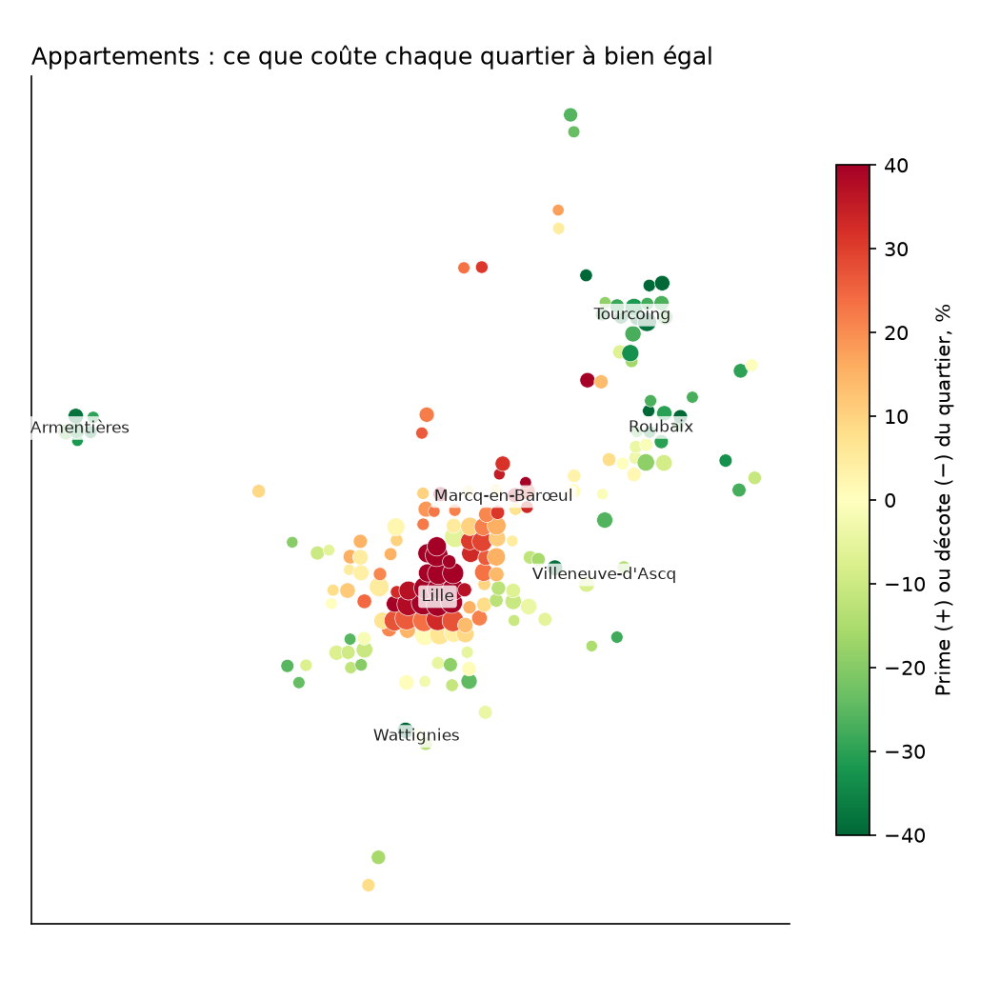
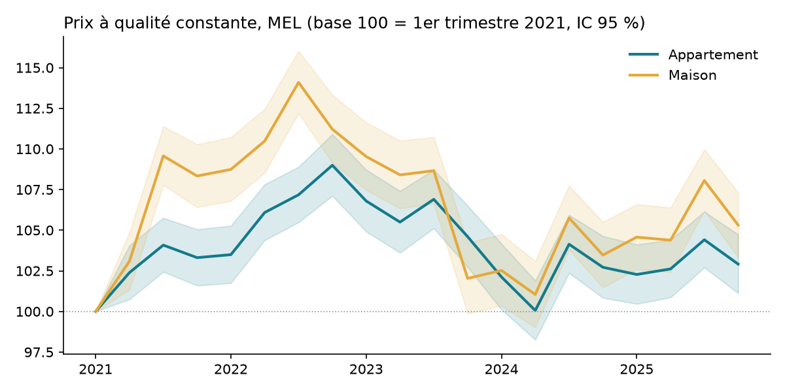

# Projet 22 — Qu'est-ce qui fait le prix d'un logement dans la métropole lilloise ?

[](https://github.com/valentinratigniet-byte/projet-22-prix-immobilier-mel/actions/workflows/ci.yml)

> **En une phrase** : sur **73 271 ventes notariées réelles** (DVF 2021-2025, 95 communes de la MEL), une
> régression hédonique isole ce que valent l'emplacement, la surface, une cave ou un parking et la
> conjoncture, **à bien égal** — puis le vérifie sur des ventes qu'elle n'a jamais vues.

**À lire en premier** : la [note de synthèse d'une page](docs/note-decideur.md) pour un décideur, puis le
[notebook d'analyse](notebooks/analyse_prix_mel.ipynb) pour la méthode.

## 🖥️ Application

Une application Streamlit (`app/app.py`) met le modèle entre les mains d'un utilisateur :
**estimer un bien** à partir d'une adresse (géolocalisée par l'API Adresse de l'État) avec une fourchette
honnête et un verdict sur le prix demandé, **carte des 181 quartiers** à bien égal, **indice des prix**.
Elle n'embarque que les coefficients du modèle (`outputs/estimateur.json`) et des agrégats par quartier :
aucune vente individuelle. Un test vérifie que son estimateur redonne les prédictions statsmodels à
10⁻⁹ près.

```bash
streamlit run app/app.py
```

## 📸 Aperçu





## 🎯 Question métier

Un prix au m² moyen par commune ne dit presque rien : à Lille, il varie du simple au double d'un quartier à
l'autre, et un 30 m² ne se vend pas au même prix au m² qu'un 90 m². La question d'un acheteur, d'un
conseiller ou d'une agence est : **ce bien est-il au prix du marché, compte tenu de ce qu'il est et de là
où il est ?** Et en corollaire : qu'est-ce qui fait vraiment le prix, et la baisse post-hausse des taux
est-elle réelle une fois les biens comparés à l'identique ?

## 📊 Résultats

| Constat | Chiffre |
|---|---|
| **L'emplacement domine** : prime/décote d'un quartier à bien égal (10ᵉ → 90ᵉ centile) | **−30 % → +37 %** |
| **Baisse 2024 vs 2022** à qualité constante, appartements / maisons | **−3,9 % / −7,1 %**, p < 10⁻¹⁷ |
| Pic du cycle par rapport à début 2021, appartements / maisons | +9 % (fin 2022) / +14 % (été 2022) |
| **Cave ou parking**, appartement | **+7,6 %** (IC 95 % : +6,8 % à +8,5 %) ; maison : non significatif |
| Doubler la surface → prix au m² | **≈ −13 %** (élasticité 0,79 à 0,82) |
| Nombre de pièces à surface égale | pas d'effet (sauf 6+ pièces en appartement : +11 %) |
| **Erreur médiane d'estimation** sur ventes non vues, appartements | **13,7 %** contre 18,4 % pour la médiane communale |
| Idem, maisons | 17,6 % contre 20,1 % |

## 🧭 Démarche

1. **Données** (`src/download.py`) : DVF géolocalisé (Etalab, data.gouv) pour le Nord, 2021-2025, et la
   liste officielle des 95 communes de la MEL (API Géo).
2. **Nettoyage** (`src/prepare.py`), chaque filtre compté dans [`docs/entonnoir.csv`](docs/entonnoir.csv) :
   de 109 808 mutations à 73 271 ventes. Piège central : une ligne DVF n'est pas une vente, et le prix est
   celui de la mutation entière — seules les ventes d'**un seul logement** sont gardées.
3. **Deux anomalies trouvées et traitées** :
   - 200 studios d'une **résidence étudiante vendus lot par lot** à Villeneuve-d'Ascq en 2021 gonflaient la
     médiane communale de 2 400 à 4 558 €/m² → règle générique (≥ 5 studios au même point la même année),
     971 ventes écartées ;
   - une « prime de quartier » de +87 % à Marcq-en-Barœul venait d'**un seul immeuble** (30 ventes sur 32)
     → toute cellule dominée à plus de 50 % par un immeuble est signalée et exclue de la carte.
4. **Modèle** (`src/model.py`) : un modèle hédonique par type de bien, MCO, écarts-types robustes HC3,
   effets fixes **quartier** (grille de ~550 m) et **trimestre**, retour en euros avec correction de Duan.
5. **Validation** : 20 % de ventes tirées au hasard et jamais vues, contre la méthode naïve « médiane €/m²
   de la commune × surface ».
6. **Résultats** (`src/analyse.py`) : indice de prix à qualité constante, test de la baisse 2024/2022,
   prime de chaque quartier, figures.

## ⚠️ Limites, dites explicitement

- **L'état du bien n'est pas dans DVF** (DPE, travaux, étage, exposition) : c'est l'essentiel de l'erreur
  restante, surtout pour les maisons. Extension naturelle : jointure avec la base DPE de l'ADEME.
- **Le neuf hors VEFA n'est pas identifiable** : un immeuble récent revendu en bloc gonfle sa cellule
  (signalée, pas corrigée).
- **Corrélation, pas causalité** : les effets se lisent « à caractéristiques observées égales ».
- **Grille fixe** de 550 m plutôt que les quartiers administratifs (IRIS).

## 🔒 Données et réutilisation

Source : *Demandes de valeurs foncières géolocalisées* (DGFiP / Etalab), Licence Ouverte. Conformément
aux conditions de réutilisation de DVF, **aucune adresse ni donnée individuelle n'est publiée** : les
données brutes sont retéléchargées par le script (non versionnées) et toutes les sorties publiées sont
agrégées par quartier d'au moins 30 ventes (vérifié par un test).

## ▶️ Rejouer l'analyse

```bash
python -m venv .venv && .venv\Scripts\activate
pip install -r requirements.txt pytest
python src/download.py      # DVF 2021-2025 (Nord) + communes MEL, ~15 Mo
python src/prepare.py       # nettoyage + docs/entonnoir.csv
python src/model.py         # modèles + validation
cd src && python analyse.py # indice, test, quartiers, figures
cd .. && pytest -q tests    # 14 tests : nettoyage, garde-fous résultats, estimateur, application
```

La CI GitHub Actions rejoue exactement ce pipeline à chaque push, depuis les sources publiques.

## 🗂️ Structure

```
├── src/
│   ├── download.py        ← DVF + communes MEL
│   ├── prepare.py         ← DVF brut → une ligne par vente (entonnoir documenté)
│   ├── model.py           ← régression hédonique + validation
│   ├── analyse.py         ← indice de prix, test, quartiers, figures
│   └── estimateur.py      ← estimation depuis estimateur.json (stdlib, utilisée par l'application)
├── app/app.py             ← application Streamlit (estimateur, carte, indice)
├── notebooks/
│   ├── analyse_prix_mel.ipynb   ← l'analyse racontée, exécutée
│   └── build_notebook.py        ← génère le notebook (la logique reste dans src/)
├── docs/
│   ├── note-decideur.md   ← synthèse d'une page
│   └── entonnoir.csv      ← chaque filtre et ce qu'il écarte
├── outputs/               ← coefficients, validation, indice, quartiers, figures
└── tests/                 ← nettoyage, garde-fous résultats, estimateur = statsmodels, application
```

---

*Projet 22 du [Portfolio Data](https://github.com/valentinratigniet-byte) — premier projet d'analyse
statistique sur données publiques réelles, construit pour le poste de Data Analyst. Réutilise l'identité
« Petrol & Ambre » du portfolio.*
